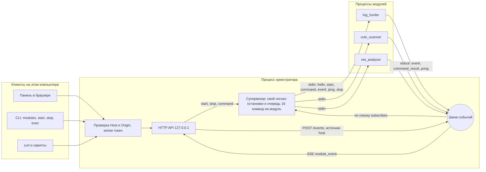
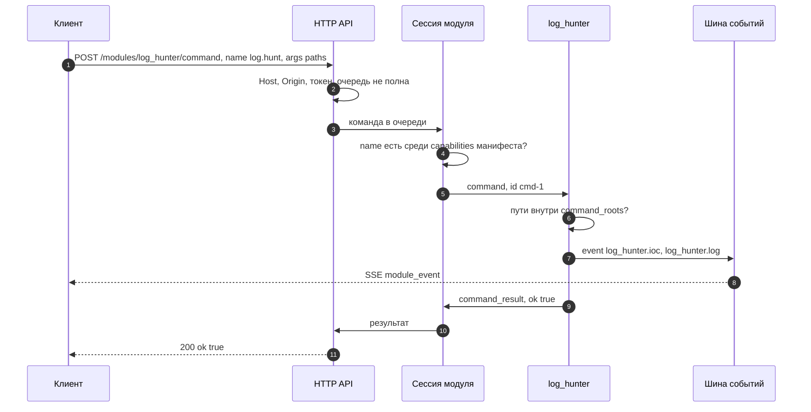
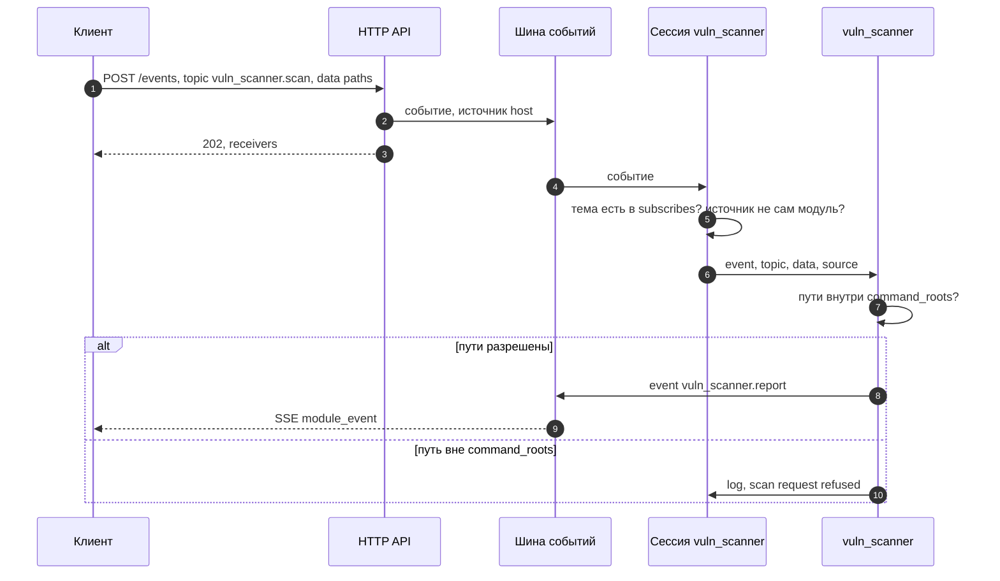
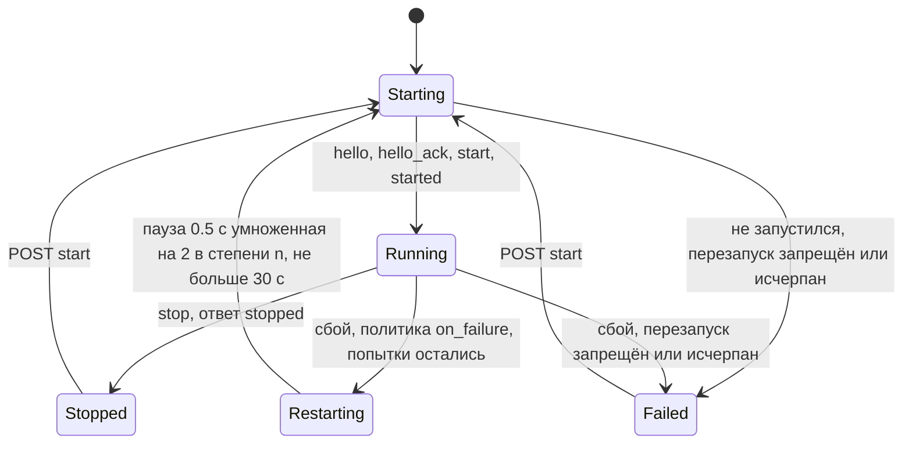

# Визуализация работы оркестратора и других приложений

Документ дополняет `docs/rust/STAGE9_UX_UI.md`. Диаграммы описывают реальное поведение кода (HTTP-API, сессии модулей, супервизор), а не желаемое. Интерактивная версия лежит в `docs/rust/ui/prototype.html`: скачайте файл и откройте в браузере, GitHub показывает его только как исходный код. Прототип имитирует данные и никуда не подключается.

## Кто участвует
| Участник | Что делает | Как общается с оркестратором |
|---|---|---|
| Панель в браузере (этап 9, не реализована) | Показывает состояние и находки, запускает проверки | HTTP на 127.0.0.1: GET /modules, SSE /events, POST start, stop, command, events |
| CLI `orchestrator` | modules, start, stop, exec | те же HTTP-запросы |
| curl и скрипты | любые запросы вручную | HTTP, включая POST /events |
| log_hunter, vuln_scanner, net_analyzer | Анализируют файлы, публикуют находки | процесс с протоколом на stdin и stdout: hello, start, command, event, ping, stop |
| C++ ModuleHost (libs/host) | Та же роль хоста для C++ части | sendCommand и приём command_result; HTTP-обвязки нет |
| Шина событий | Рассылает события всем подписчикам | внутри процесса оркестратора |

## Общая схема

## Команда модулю
Сценарий: пользователь запускает проверку лога.

Если что-то из проверок не прошло, ответ приходит раньше: 403 (Host или Origin), 401 (токен), 404 (нет модуля), 409 (не запущен), 429 (очередь полна). Отказ модуля приходит как `ok: false` с текстом `error`. Если модуль не ответил за 30 секунд, клиент получает 504, а работа модуля при этом может продолжаться. Если модуль завершился, не ответив, клиент получает 502.

## Событие от хоста
Сценарий: клиент публикует `vuln_scanner.scan`.

Ответ 202 не означает, что модуль получил событие: `receivers` считает всех получателей шины, в том числе SSE-клиентов.

## Жизненный цикл модуля

Политика и число попыток берутся из манифеста: у `log_hunter` и `vuln_scanner` это `on_failure` с двумя попытками, у `net_analyzer` перезапуск не разрешён.

## Что видит пользователь
| Событие внутри | Как показано в панели |
|---|---|
| Состояние модуля изменилось | Строка таблицы: значок, слово и цвет; причина сбоя под строкой |
| Модуль упал и перезапускается | Состояние «Перезапуск (попытка N)», узел на схеме мигает |
| Пришло событие находки | Строка в ленте, отсортированной по важности, затем по времени; сообщение в зоне `role=status` |
| Критическая находка или потеря связи | Сообщение в зоне `role=alert` |
| Любое сообщение между участниками | Строка в журнале и движущийся значок на схеме: круг (HTTP, SSE), квадрат (событие), ромб (команда и результат) |
| События пропущены (`lagged`) | Метка «пропущено N событий» в ленте |

## Что показывает прототип
- Сценарии: проверка модуля, имитация сбоя, остановка, запуск, событие от хоста (с отказом по пути вне `command_roots`).
- Схема повторяет реальные пути сообщений. Для пользователей, отключивших анимацию в системе (`prefers-reduced-motion`), движение заменено подсветкой.
- Всё то же самое дублируется в таблице журнала, поэтому схема не единственный источник информации.
- Данные демонстрационные: имена правил и описания находок взяты из тестов модулей, но сами находки выдуманы.

## Ограничения
- Прототип не проверялся в разных браузерах и со скринридерами; это нужно сделать до реализации.
- Реальный поток SSE нужно читать через `fetch`, потому что встроенный `EventSource` не отправляет заголовок `Authorization`; подробности в `STAGE9_UX_UI.md`.
- Для `net_analyzer` и C++ антивируса на схеме показаны только те связи, которые реализованы в коде.
